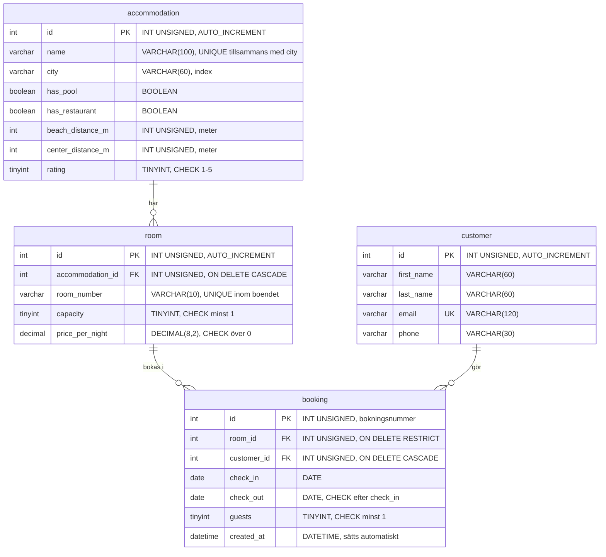

# Holiday Maker

En relationsdatabas i MySQL och en konsolapplikation i C# för en
resebyråoperatör som bokar semesterboenden åt kunder över telefon.
Operatören kan registrera och välja kund, söka lediga rum, boka, visa
kundens bokningar, ändra antal personer och avboka.

## Innehåll

```
README.md                    Den här filen
sql/01_create_database.sql   Skapar databasen: tabeller, nycklar, villkor, triggers, användare
sql/02_testdata.sql          Testdata: 6 boenden, 22 rum, 5 kunder, 25 bokningar
sql/03_testfragor.sql        Programmets SQL-frågor, körbara i en databasklient
src/HolidayMaker/            Konsolapplikationens källkod
docs/er-diagram.pdf          E/R-diagram
docs/testprotokoll.md        Hur lösningen är testad, och resultaten
docs/reflektion.pdf          Individuell reflektion
flodesschema.html            Klickbart flödesschema: varje steg i programmet med koden bakom
databasschema.html           Klickbart E/R-diagram: varje tabell, kolumn och relation med SQL-koden bakom
```

Källkoden består av sex filer:

| Fil | Innehåll |
| --- | --- |
| `Program.cs` | Startar programmet och kontrollerar att databasen går att nå |
| `App.cs` | Menyn och följdfrågorna – ett menyval per funktion i uppgiften |
| `Repository.cs` | All SQL. En metod per fråga, alla med parametrar |
| `Input.cs` | Inläsning som frågar om i stället för att krascha |
| `Models.cs` | Dataklasserna: kund, ledigt rum, bokning, sökvillkor |
| `Db.cs` | Läser anslutningssträngen och öppnar anslutningar |

**Flödesschema:** [öppna det klickbara flödesschemat](https://aliteex55-bit.github.io/hej/flodesschema.html).
Klicka på ett steg för att se den C#-kod som utför det, med en kort förklaring.

## E/R-diagram

Fyra tabeller och tre relationer. Ett boende har många rum, och varje
bokning gäller ett rum och en kund. Samma diagram finns som PDF i
`docs/er-diagram.pdf`.

**Klickbart:** [öppna det klickbara E/R-diagrammet](https://aliteex55-bit.github.io/hej/databasschema.html).
Klicka på en tabell, kolumn eller relation för att se SQL-koden bakom, med en kort förklaring.




## Förutsättningar

- MySQL Server 8.0.16 eller senare (CHECK-villkor kontrolleras först från den versionen)
- .NET SDK 10
- En databasklient: MySQL Workbench, eller kommandot `mysql` som följer med servern

## 1. Skapa databasen

Kör `sql/01_create_database.sql` som en användare som får skapa databaser
och användare, till exempel `root`.

I MySQL Workbench: öppna filen och kör hela skriptet.

Från en terminal:

```bash
mysql -u root -p --default-character-set=utf8mb4 < sql/01_create_database.sql
```

Skriptet gör tre saker, i den här ordningen:

1. Skapar databasen `holiday_maker` med fyra tabeller. **En befintlig
   databas med samma namn tas bort först**, så att skriptet alltid går att
   köra om från början.
2. Skapar två triggers som vaktar de regler som inte går att skriva som
   CHECK-villkor: att sällskapet ryms i rummet, och att ett rum inte
   dubbelbokas.
3. Skapar användaren `holiday_app`, som programmet kopplar upp som. Den får
   bara läsa och ändra rader i den här databasen – inte skapa eller ta bort
   tabeller.

## 2. Lägg in testdata

```bash
mysql -u root -p --default-character-set=utf8mb4 < sql/02_testdata.sql
```

Skriptet avslutas med en räkning som ska visa **6 boenden, 22 rum, 5 kunder
och 25 bokningar**. Det tömmer tabellerna först och går därför att köra om
när som helst för att få tillbaka utgångsläget.

Flaggan `--default-character-set=utf8mb4` gör att å, ä och ö i testdatat
läses in rätt även på Windows.

## 3. Kontrollera anslutningen

Programmet läser anslutningen från `src/HolidayMaker/config.json`:

```json
{
  "connectionString": "Server=localhost;Port=3306;Database=holiday_maker;User ID=holiday_app;Password=Byt_mig_123!;"
}
```

Användaren och lösenordet är de som skriptet i steg 1 skapade, så filen
behöver inte ändras om skriptet kördes som det är. Byter du lösenord i
skriptet ska samma lösenord stå här. Miljövariabeln `HOLIDAYMAKER_CONNSTR`
går före filen om den är satt.

## 4. Kör programmet

```bash
cd src/HolidayMaker
dotnet run
```

## Så används programmet

| Val | Funktion |
| --- | --- |
| 1 | Välj en befintlig kund ur listan, eller registrera en ny |
| 2 | Sök lediga rum |
| 3 | Skapa en bokning åt den valda kunden |
| 4 | Visa den valda kundens bokningar |
| 5 | Ändra antal personer i en av kundens bokningar |
| 6 | Avboka en av kundens bokningar |
| 0 | Avsluta |

Val 3–6 gäller den kund som är vald, och kräver därför att en kund har
valts med val 1. Skriv `avbryt` vid vilken fråga som helst för att gå
tillbaka till menyn utan att något sparas.

**Sökningen (val 2)** frågar i tur och ordning efter ort, incheckning,
utcheckning och antal personer. Orterna visas i en numrerad lista och kan
väljas med sitt nummer eller sitt namn. Därefter kommer de valfria filtren
– pool, restaurang, högsta avstånd till strand och till centrum – där
Enter hoppar över ett filter. Sist väljs sortering: lägst pris först
(Enter) eller högst omdöme först.

**Bokningen (val 3)** utgår från den senaste sökningen, så att ort och
datum inte behöver skrivas in en gång till. Sökningen körs om mot
databasen, och operatören väljer ett rum ur listan. Finns ingen tidigare
sökning ställs sökfrågorna först.

**Bokningsbar period.** Uppgiften anger att alla rum kan bokas under
december 2026. Programmet tar därför emot incheckning 2026-12-01 till
2026-12-31. Eftersom utcheckningsdagen inte upptar rummet kan
utcheckningen som senast vara 2027-01-01.

### Ett genomlopp att prova

Med testdatat nyinläst ger de här stegen exakt de här svaren:

| Steg | Inmatning | Resultat |
| --- | --- | --- |
| Välj kund | `1`, sedan `1` | Vald kund: Anna Lindqvist |
| Sök | `2`, ort `2` (Malmö), `2026-12-14`, `2026-12-16`, `2`, Enter fem gånger | 4 lediga rum: 101, 102, 203, 103 |
| Boka | `3`, Enter, rum-id `2` | Bokningsnummer 26, rum 102, 2 nätter × 1 450,00 kr = 2 900,00 kr |
| Visa | `4` | 6 bokningar, den nya med nummer 26 |
| Ändra | `5`, `26`, `4` | Nekas: rum 102 tar högst 2 personer |
| Ändra | `5`, `26`, `1` | Bokning 26 gäller nu 1 person |
| Avboka | `6`, `26`, `j` | Bokning 26 är avbokad, rum 102 är ledigt igen |

### Fler sökningar mot testdatat

| Sökning | Resultat |
| --- | --- |
| Malmö, 2026-12-01 till 2026-12-05, 2 personer | 202, 102 och 203. Rum 101 saknas – det är bokat just de dagarna |
| Malmö, 2026-12-13 till 2026-12-16, 2 personer | Rum 102 finns med, fast en annan gäst checkar ut ur det den 13:e |
| Göteborg, 2026-12-10 till 2026-12-13, 2 personer, måste ha pool | 302, 303 och 304 – bara Hotell Hamnkrogen har pool |
| Samma, plus högst 100 m till strand | Inga lediga rum: Hamnkrogen ligger 2 500 m från stranden |
| Visby, 2026-12-10 till 2026-12-12, 8 personer | Inga lediga rum: inget rum i Visby rymmer 8 personer |
| Göteborg, 2026-12-23 till 2026-12-27, 6 personer | Inga lediga rum: det enda rummet för 6 är bokat 23–30 december |

## SQL-frågorna i en databasklient

`sql/03_testfragor.sql` innehåller samma frågor som `Repository.cs`, med
värdena satta som variabler i stället för parametrar. Filen består bara av
SELECT-frågor och ändrar ingenting:

```bash
mysql -u root -p --default-character-set=utf8mb4 --table < sql/03_testfragor.sql
```

Varje fråga har en kommentar som säger vilket svar som väntas mot testdatat.

I Kommandotolken på Windows: skriv `chcp 65001` först, så visas å, ä och ö
rätt i utskriften. Det påverkar bara vad som syns i fönstret, inte
uppgifterna i databasen.

## Felsökning

**"Kunde inte ansluta till databasen"** – MySQL-servern är inte igång,
eller användare och lösenord i `config.json` stämmer inte med dem som
skriptet i steg 1 skapade.

**"Unknown database 'holiday_maker'"** – skriptet i steg 1 har inte körts.

**"Det finns inga boenden i databasen"** – skriptet i steg 2 har inte körts.

**Fel på raden `CREATE USER` i steg 1** – kontot som kör skriptet får inte
skapa användare. Databasen är ändå färdig, eftersom användaren skapas
sist. Ange då ett eget konto i `config.json`.

**`Illegal mix of collations` i en egen fråga i databasklienten** –
databasen använder svensk sorteringsordning (`utf8mb4_swedish_ci`). Inled
sessionen med `SET NAMES utf8mb4 COLLATE utf8mb4_swedish_ci;`, som
`03_testfragor.sql` gör.
